# ぷちくる rev2 取扱説明書
ぷちくるをご購入いただきありがとうございます。

## 基板の見分け方

メイン基板の裏面に **「V2」（数字の 2）** の印字があれば **rev2** です。印字がなければ **rev1** です。[rev1 の取扱説明書](../petitcuru/README.md)を参照してください。

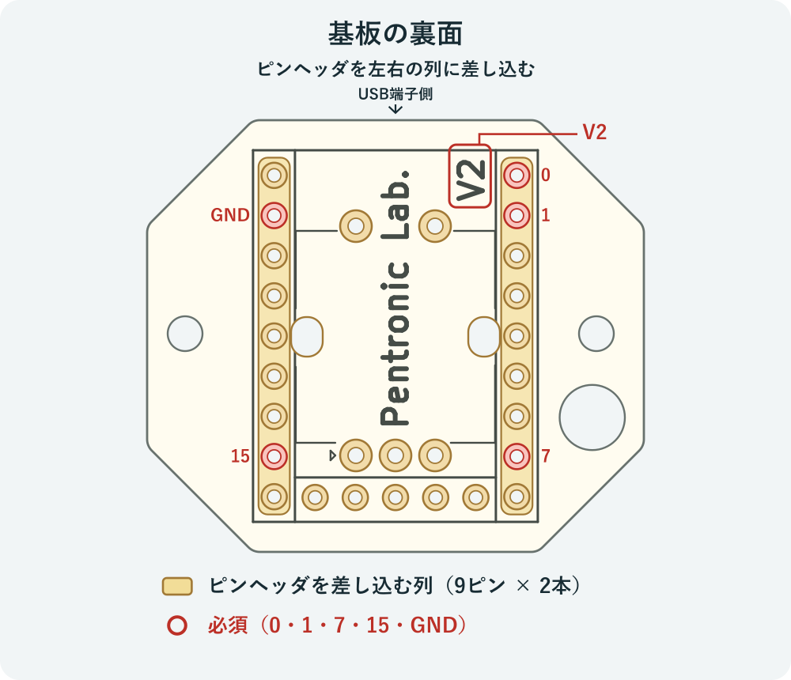

## 1. 注意事項
> [!WARNING]
> 本製品はDIYキットです。はんだごてを含む怪我の危険性のある機器を使用する必要があります。十分注意して作業を行うようにしてください。
>
> また、本製品は完成後、コンピュータ等に接続することで、USBキーボードとして使用することができますが、本製品の使用によって発生するいかなる損失についても、本製品の使用者は自己責任とします。

## 2. 内容物と別途必要なもの

| 品名 | 数量 |
|------|------|
| メイン基板 | 1枚 |
| ボトムプレート | 1枚 |
| オリジナルノブ | 1個 |
| ロータリーエンコーダー | 1個 |
| RP2040-Zero | 1個 |
| ピンヘッダ（9ピン） | 2本 |
| M2 5mmネジ | 4本 |
| M2 10mm スペーサー | 2本 |

他に組み立て時に、はんだづけ用の器具、ドライバーが必要です。

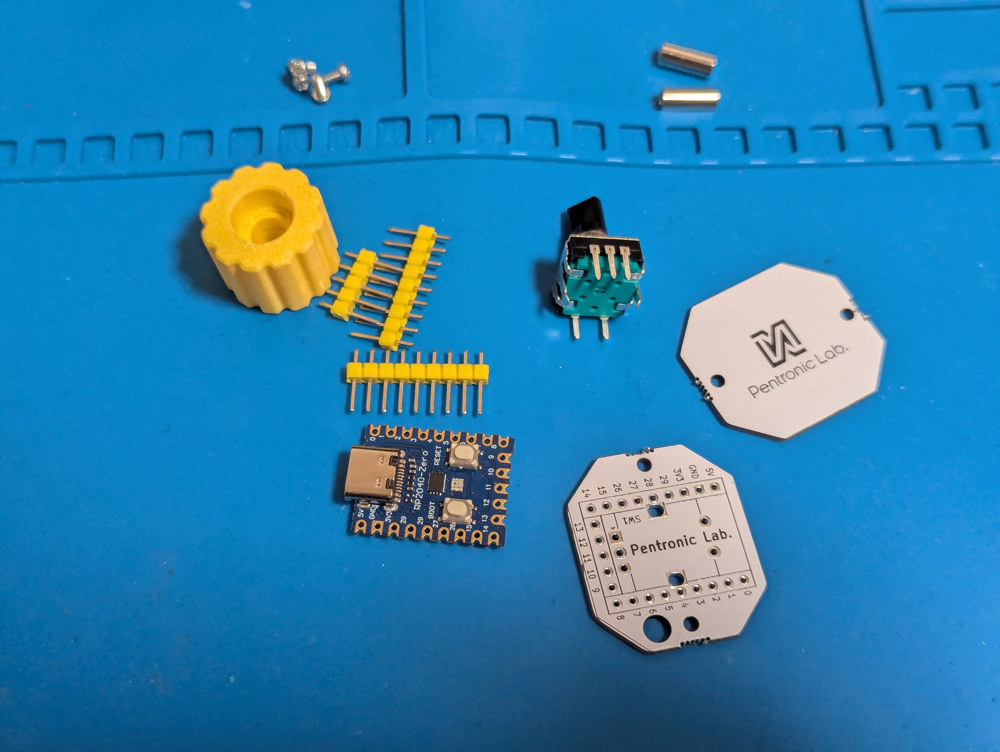

写真は rev1 のものです。rev2 で使うのは左右の9ピンのピンヘッダ2本です。

## 3. 組み立て方

写真は rev1 のものを使用しています。ピンヘッダの位置と、はんだ付けするピンは rev2 の図を確認してください。

### 1. ロータリーエンコーダーを差し込む

> [!WARNING]
> はんだ付けミスを防ぐため，まずは差し込むだけにしてください．

まず、ロータリーエンコーダーを基板に差し込みます。このとき、**もころんやロゴが印刷されているほうが、上側になるようにしてください**

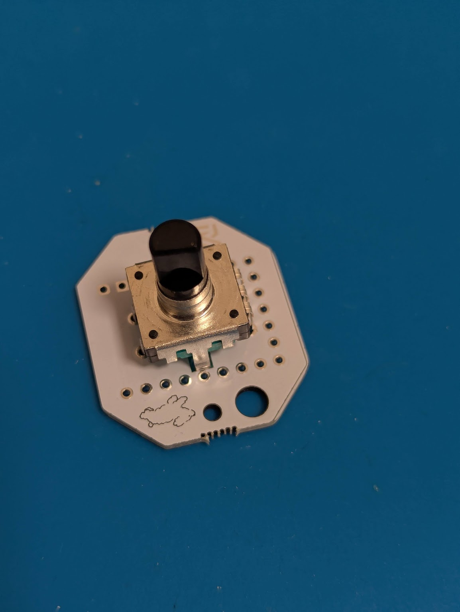

裏側から見るとこのようになります。

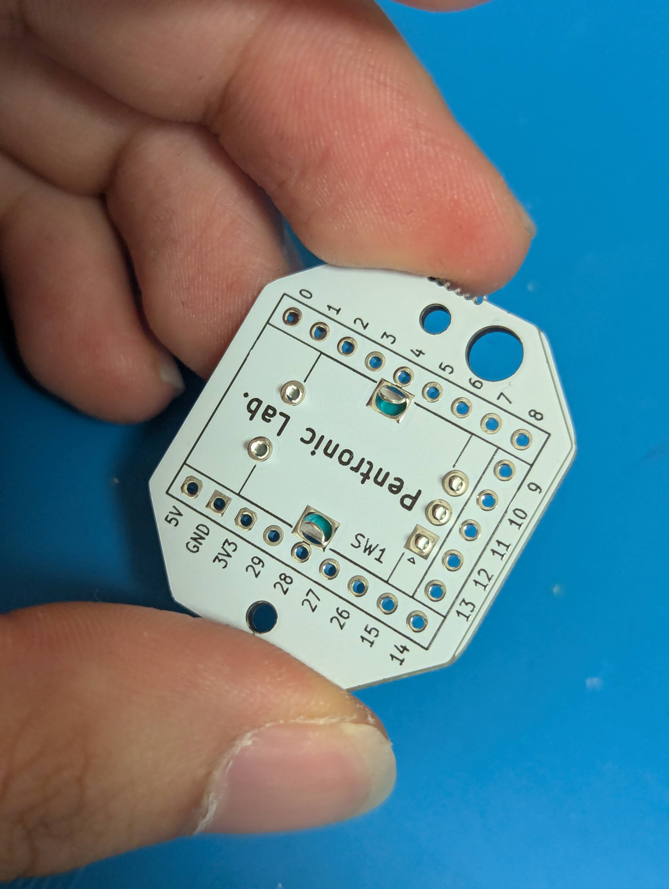

### 2. ピンヘッダを基板にはんだ付けする

メイン基板を裏返し、「V2」が見える面から、[裏面の図](../assets/petitcuru_rev2/pcb-back.png)で黄色に示した左右の列に、9ピンのピンヘッダを1本ずつ差し込みます。端の横一列（9〜13）の穴は空けておきます。

樹脂の部分を基板の裏面に当て、短い足を基板に差し込みます。長い足は裏面に残し、あとで RP2040-Zero を差し込めるようにします。

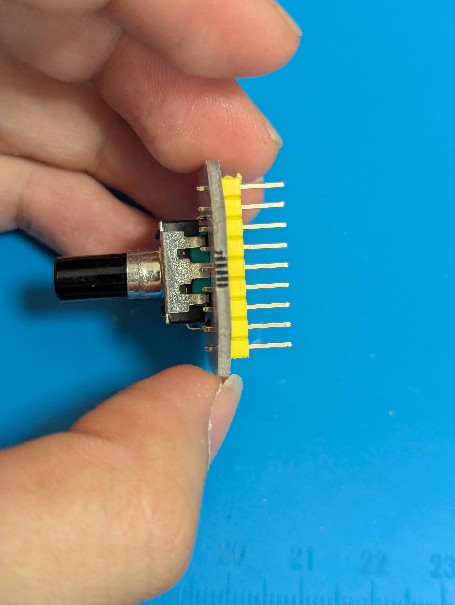

エンコーダーの軸がある表面から、下の図で赤く示した **0・1・7・15・GND** の5点をはんだ付けします。

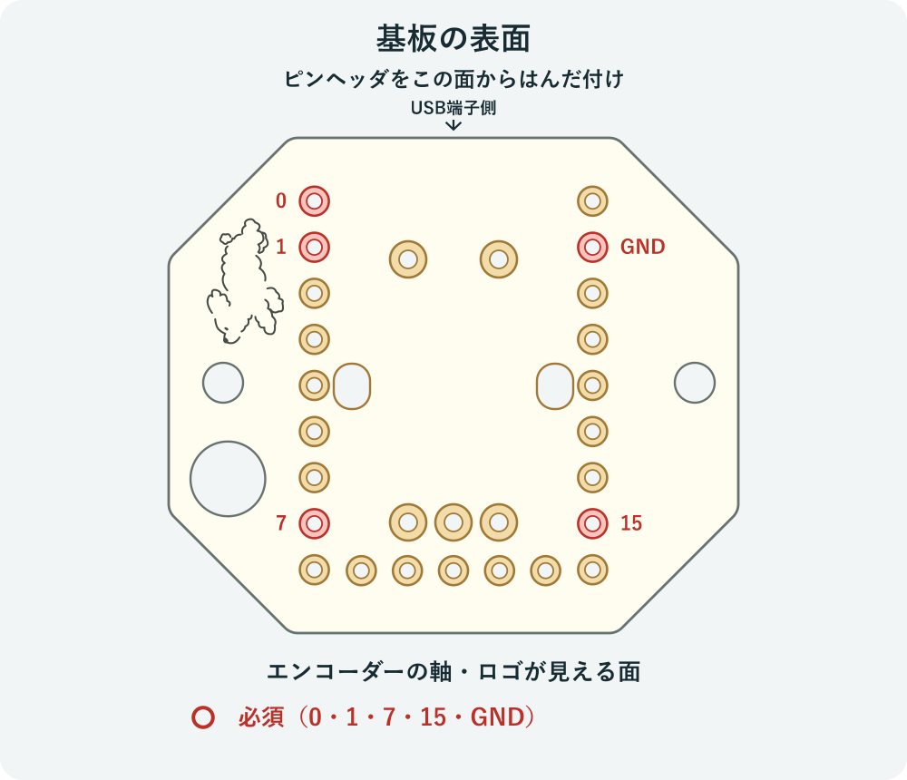

はんだ付けのやり方は、[イチケンさんの動画](https://www.youtube.com/watch?v=dQ7AUjb1tkA)を参考にしてください。

### 3. ロータリーエンコーダーをはんだ付けする

差し込んであるロータリーエンコーダの裏側をはんだ付けします。このとき、実際の回路に使われているのは、3ピンが横に並んでいる部分とその反対側の2ピンの部分なので、その部分のみはんだ付けし、爪ははんだ付けしなくても大丈夫です。

はんだ付けが終わった後はこのようになります。

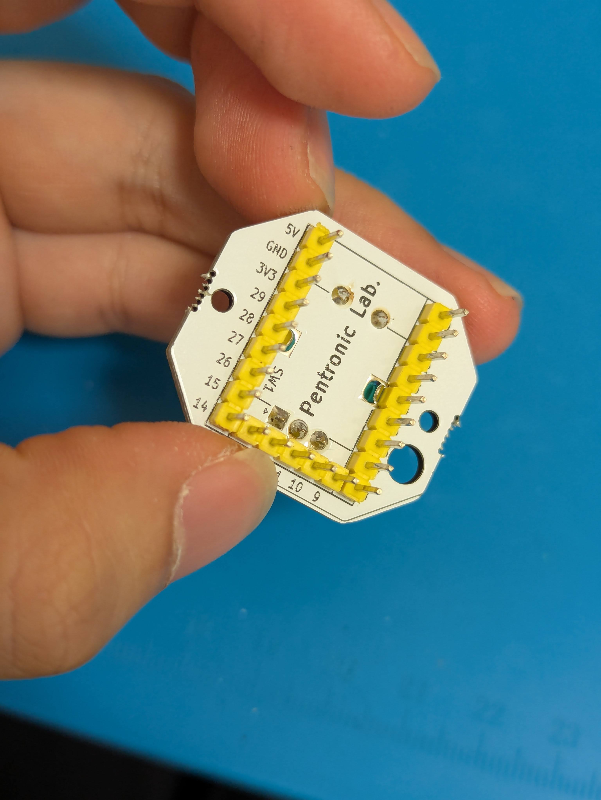

### 4. RP2040-Zero をピンヘッダにはんだ付けする

メイン基板の裏面に RP2040-Zero を差し込みます。白い BOOT・RESET ボタンが外側を向くようにし、USB-C 端子を[裏面の図](../assets/petitcuru_rev2/pcb-back.png)の「USB端子側」に合わせます。

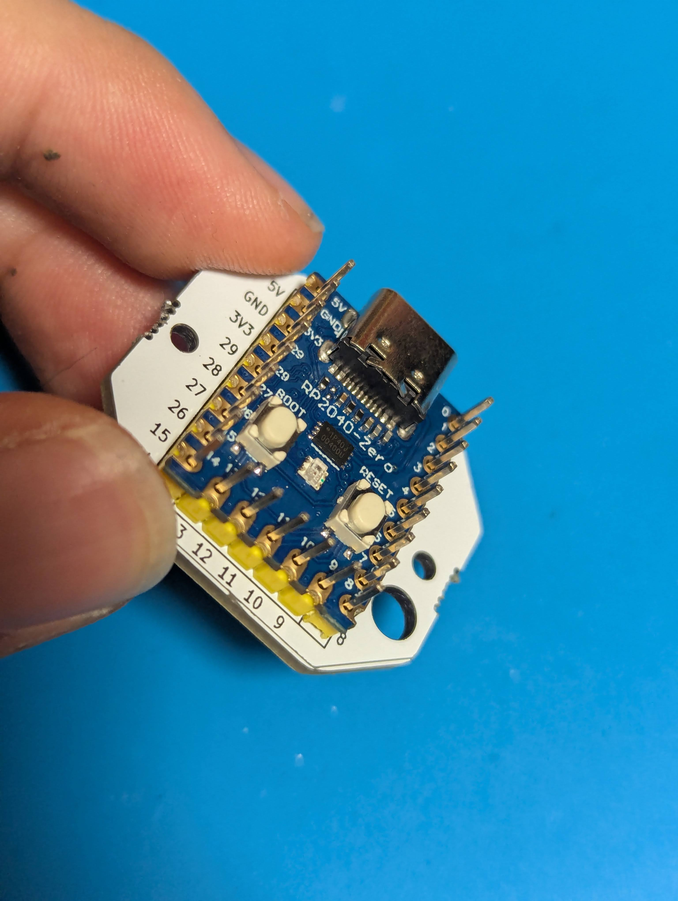

RP2040-Zero 側でも **0・1・7・15・GND** の5点をはんだ付けします。USB をつなぐ前に、隣のピンとはんだがつながっていないか確認してください。

### 5. ファームウェアを書き込む

ボトムプレートを取り付ける前に書き込みます。

1. [rev2 用ファームウェア](https://github.com/uNikks/Pentronic-Lab/releases/tag/petitcuru_rev2)から `petitcuru_rev2_vial.uf2` をダウンロードします。
2. データ通信に対応した USB-C ケーブルでパソコンと接続します。
3. `RPI-RP2` ドライブが表示されない場合は、接続したまま **BOOT** ボタンを押しながら **RESET** ボタンを押し、RESET、BOOT の順に離します。
4. `petitcuru_rev2_vial.uf2` を `RPI-RP2` ドライブにドラッグ＆ドロップします。書き込みが終わると自動で再起動します。
5. ノブを右に回すと音量が上がり、左に回すと音量が下がり、押すとミュートが切り替わることを確認します。

### 6. ボトムプレートを取り付ける
最後に、完成に向けてボトムプレートを取り付けます。

まず、ボトムプレートにネジを差し込み、上からスペーサーを手で回してはめます。

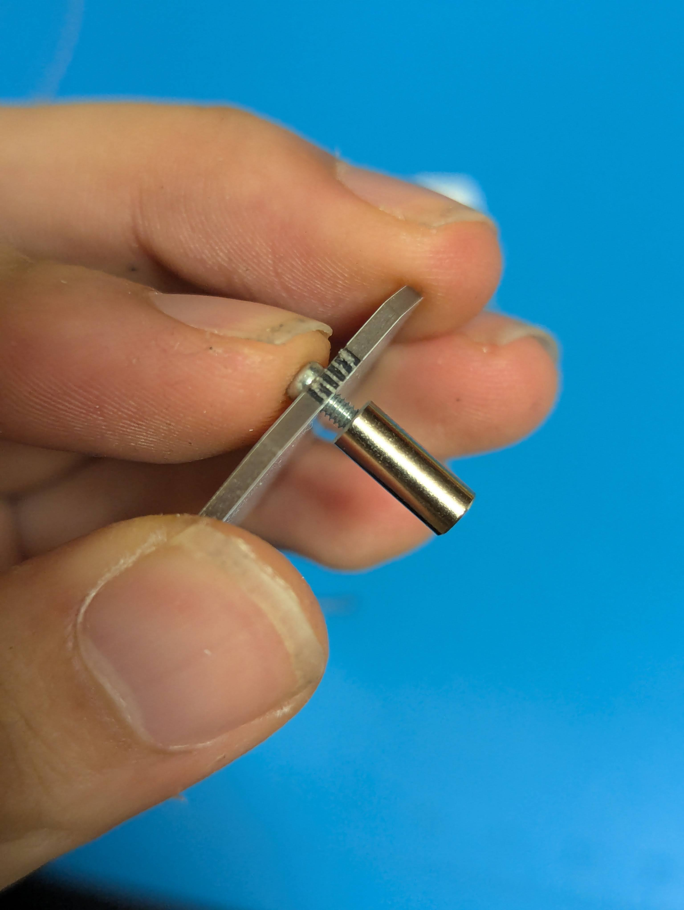
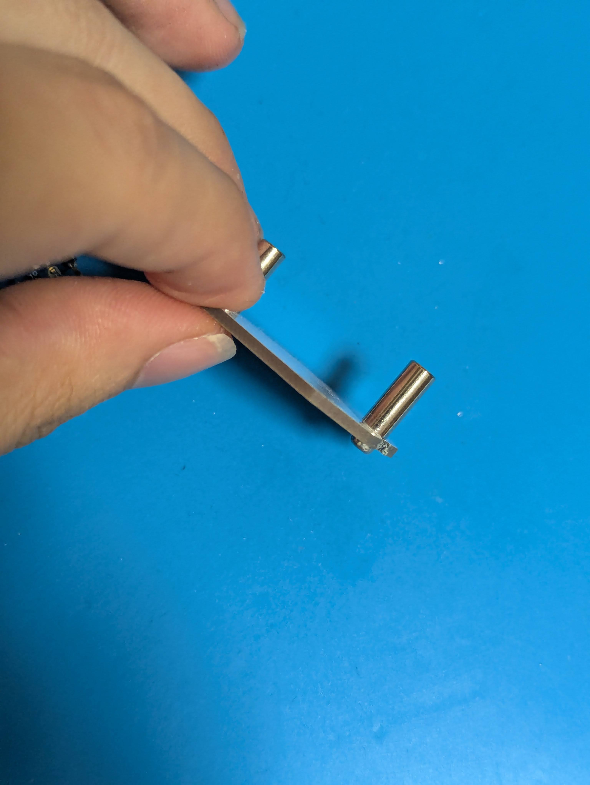

上から先ほどまで組み立てていた本体を載せて、ネジで締めてください。
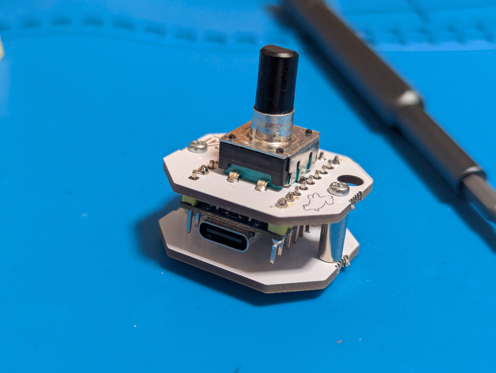

最後に、上からノブを取り付ければ完成です！
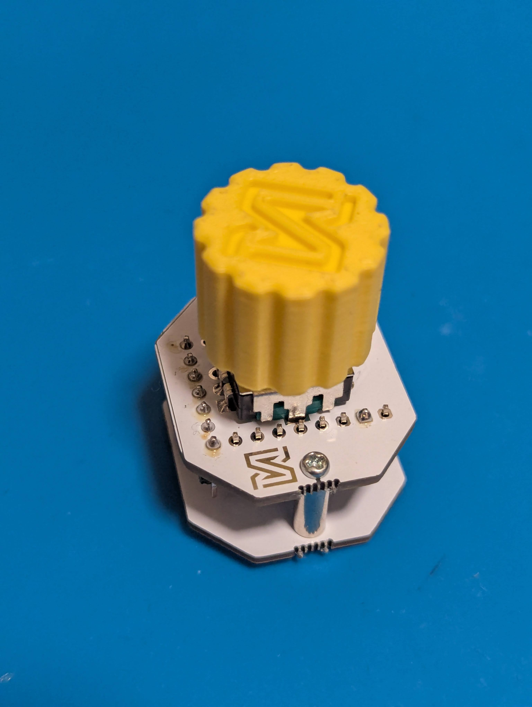

## 4. 自分オリジナルにカスタマイズする！
rev2 用ファームウェアを書き込むと、Vial で回転と押し込みに割り当てるキーを変更できます。

[vial](https://vial.rocks/)にアクセスし、Start Vial を押し、petitcuru rev2 を選択して、キーマップを変更してください。

vialの詳しい使用法については、[サリチル酸さんの記事](https://salicylic-acid3.hatenablog.com/entry/vial-manual)をご覧ください。
