# Pacer ユーザガイド

- [**[組み立て手順]**](#組み立て)
- [**[使い方]**](#使い方)

## 組み立て

> [!WARNING]
> 本製品はDIYキットです．
>
> 手順を誤った場合，やり直しが困難になるため，**必ず組み立て手順を守り，よく手順を確認してから作業を行ってください**．
>
> 細かい部品が含まれているため，誤飲等に注意してください．
> また，本製品の使用によって発生するいかなる損失についても，使用者の自己責任とします。

### 内容物と別途必要なもの

> [!NOTE]
> 試作品にて組み立て方法を撮影しています．実際の商品と見た目は異なりますが，組み立て方法は同じです．

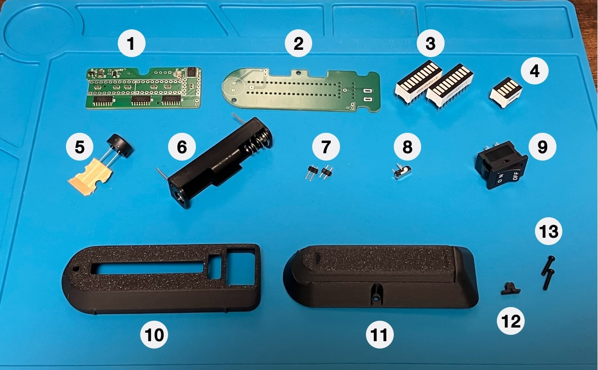

|.| 内容物 | 個数 |
|------|------|------|
|(1)| 基板A | 1 |
|(2)| 基板B | 1 |
|(3)| LEDアレイ（10P） | 2 |
|(4)| LEDアレイ（5P） | 1 |
|(5)| ブザー | 1 |
|(6)| 電池ホルダー | 1 |
|(7)| 2Pピンヘッダ | 2 |
|(8)| スライドスイッチ | 1 |
|(9)| 電源スイッチ | 1 |
|(10)| ケース（前） | 1 |
|(11)| ケース（後） | 1 |
|(12)| スイッチカバー | 1 |
|(13)| M2 10mmネジ | 2 |

もし不足があった場合は，お問い合わせより報告をお願いいたします．
組み立てにはM2ネジを留めるための精密ドライバー，ニッパー，はんだづけ用の工具が必要です．
また，使用にあたって単三形乾電池または充電式ニッケル水素電池（エネループ等）が必要です．

### 基板Aの実装

まず，基板A（部品が実装されている，小さい方の基板）に部品を実装します．

#### スライドスイッチの取り付け

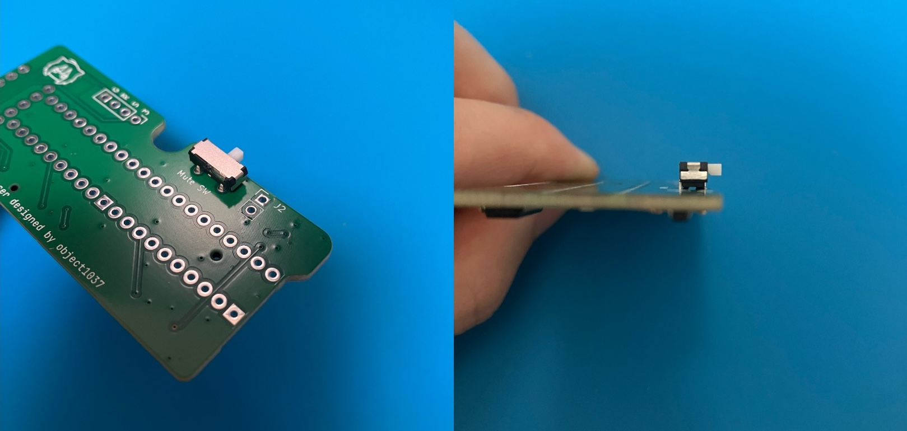

スライドスイッチを基板Aの**裏面（部品がついていない面）**から，写真のように取り付け，はんだ付けします．
はんだ付けのやり方については，[イチケンさんの動画](https://www.youtube.com/watch?v=dQ7AUjb1tkA)がわかりやすく，おすすめです．

一箇所はんだ付けしたら，横から見て基板から浮いていないことを確認してください．
浮いている場合，はんだを溶かして調整してください．

#### LEDアレイの取り付け

> [!WARNING]
> **LEDアレイの向きに注意！**

LEDアレイ表面に保護フィルムが付いている場合，剥がしてください．

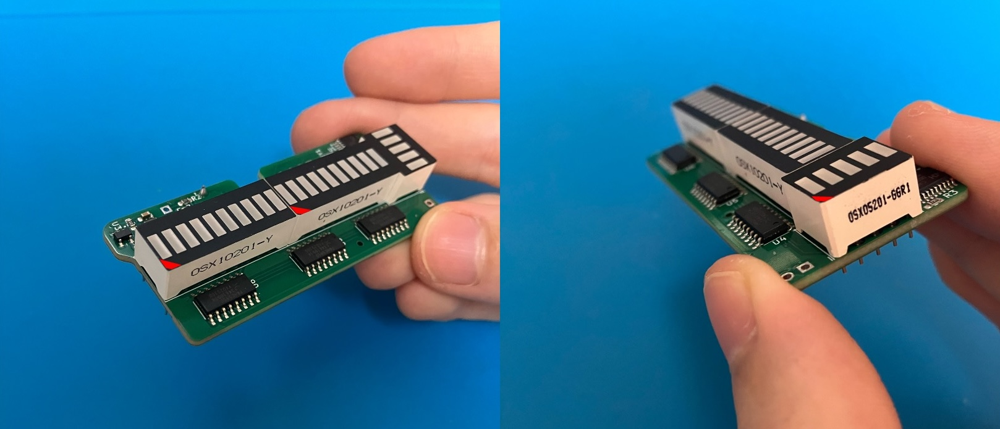

LEDアレイを基板Aの**表面（先ほどはんだ付けした面）**から，写真のように差し込みます．
LEDアレイには，文字が印刷されている面があります．
この面が写真と同じ向きになるように，LEDアレイを差し込みます．

> [!TIP]
> 文字が見当たらない場合：切り欠きがあるカドを探し，そのカドが写真と同じ部分に来るように差し込んでください．

正しい向きに差し込んだら，はんだ付けします．
**まずは3つの四角いパッドをはんだ付けし，仮固定**してください．
このとき，LEDが浮いていたり，傾いていたら，はんだを溶かして調整してください．
浮きや傾きがなければ，続いてすべてのピンをはんだ付けしてください．

#### 基板Aの動作確認

基板Aの動作を確認します．

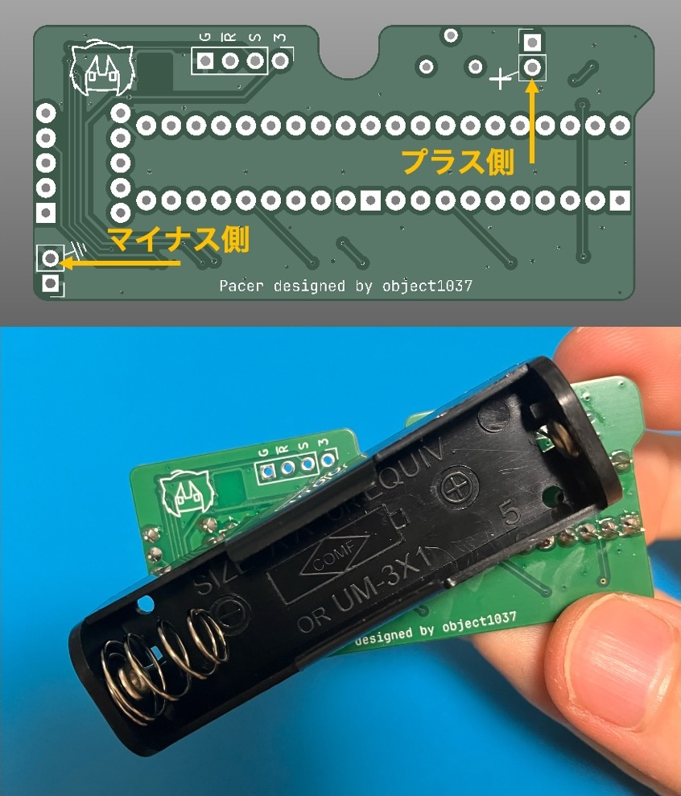

電池ホルダーを基板Aの裏面から，写真のように差し込みます（**向きに注意・はんだ付けはしない**）．
LEDアレイが見えるように基板を持ち，電池を挿入します．
全てのLEDが数秒間点灯することを確認してください．

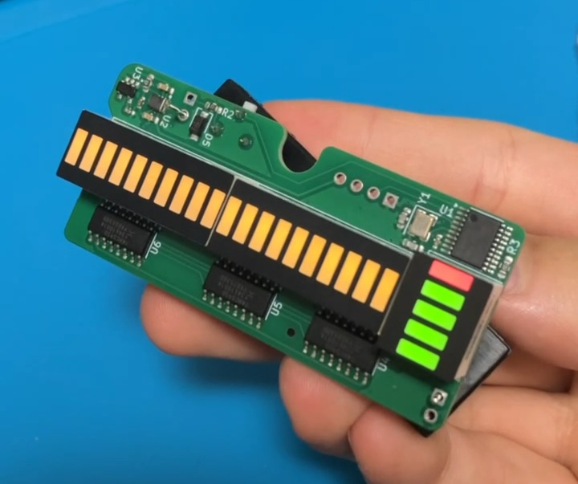

一部のLEDが点灯しない場合，電池ホルダーを取り外し，LEDのはんだ付けを確認してください．

LEDの点灯を確認したら，電池を取り外し，電池ホルダーを外してください．

### 基板Bの実装

次に，基板B（大きい方）に部品を実装します．

#### 2Pピンヘッダの取り付け

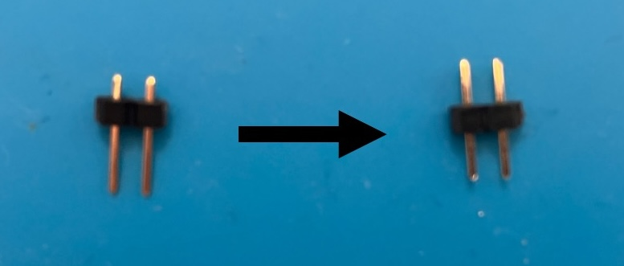

ピンヘッダの黒い部分を，爪や硬いもので押し込んで中心に寄せてください．

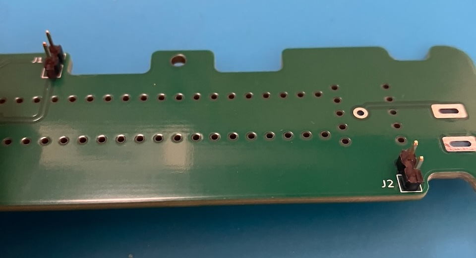

2Pピンヘッダを，**ロゴ等が書いていない面**から写真のように差し込み，はんだ付けします．
傾いている場合，はんだを溶かして調整してください．

#### ブザーの取り付け

ブザーの足を1cm程度残して，台紙から切り離します．

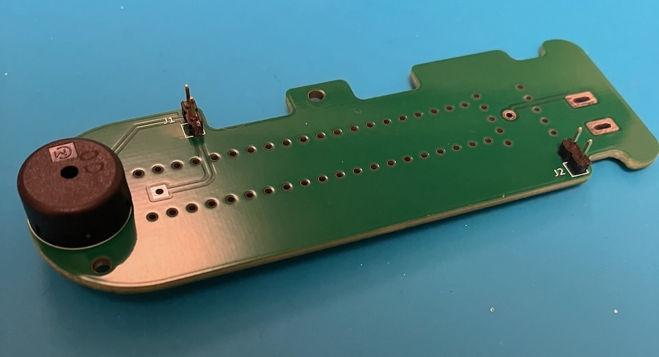

基板Bの**ピンヘッダが見える面**からブザーを差し込みます（差し込み方向が合っていればブザーの上下は関係ありません）．
次に，どちらか一方の端子をはんだ付けし，ブザーに浮きや傾きがなければ，続いてもう一方の端子をはんだ付けしてください．

#### 電池ホルダーの取り付け

> [!WARNING]
> **電池ホルダーの向きに注意！**

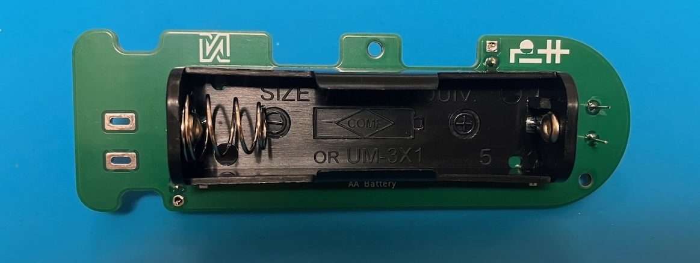

電池ホルダーを，**基板Bのブザーが見えない面**から写真のように差し込み，はんだ付けします．
電池ホルダーの向きに注意してください．

### 基板の組み立て

#### 余分な足のカット

> [!WARNING]
> 部品の足（ピン）を切るときは，必ず指でピンを押さえて切ってください．
> ピンの切れ端が飛んでくることがあります．

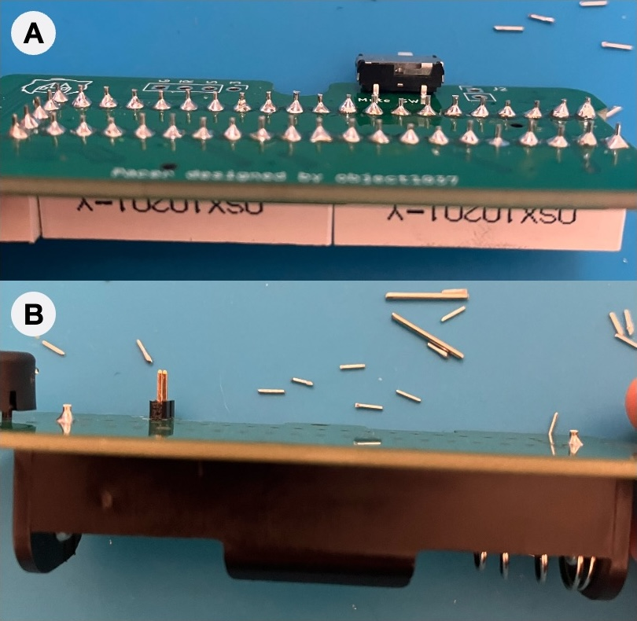

LEDアレイの足と電池ホルダーの足を，写真の長さ程度までニッパーで切ってください．

#### 基板同士のはんだ付け

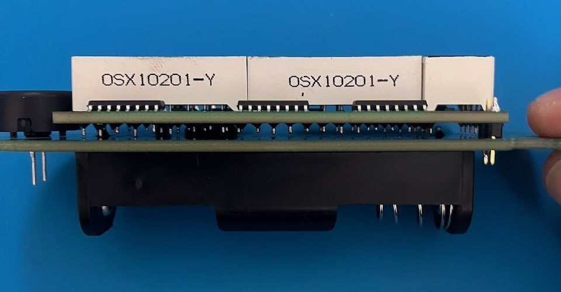

写真のように，基板Aの穴に基板Bのピンヘッダを差し込みます．
奥まで刺さらない場合，先程切ったLEDアレイの足または電池ホルダーの足が干渉していることが考えられるため，余分な足を切ってください．

差し込んだら，**まず片方のピンヘッダのみを（基板A側から）はんだ付けし，両方のピンヘッダが穴に奥まで刺さっていること，基板間が平行であることを確認してください**．
傾いている・浮いている場合，はんだを溶かして調整してください．
確認できたら，続いてもう一方のピンヘッダをはんだ付けしてください．

### ケースの組み立て

#### 電源スイッチの取り付け 

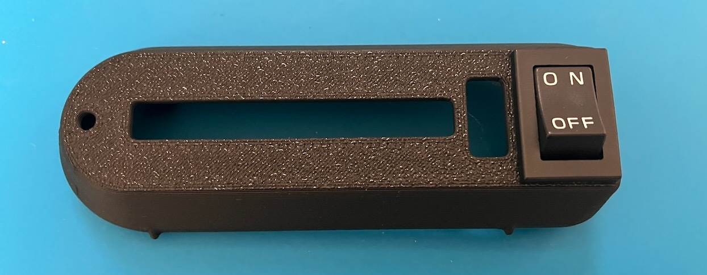

ケース（前）の穴に電源スイッチをカチッと鳴るまではめ込みます．
次に，先ほど組み立てた基板をケース（前）に収めます．

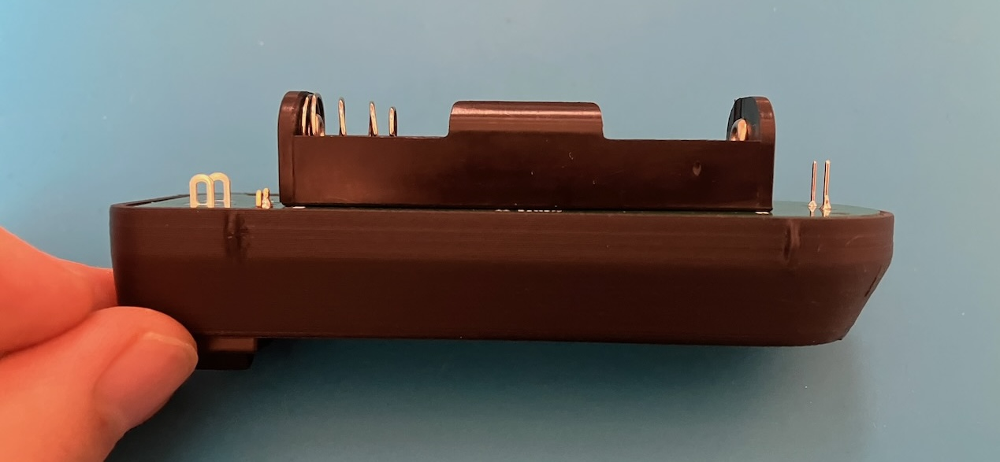

このとき，**基板Bの裏面がケースにぴったりと収まることを確認してください**．
押し込んでも収まらない場合，先ほど組み立てた基板が傾いている・奥まで刺さっていないことが考えられるため，はんだを溶かして調整してください．
基板がぴったり収まっていることを確認したら，**電源スイッチをはんだ付けしてください**．

#### スイッチカバーの取り付け

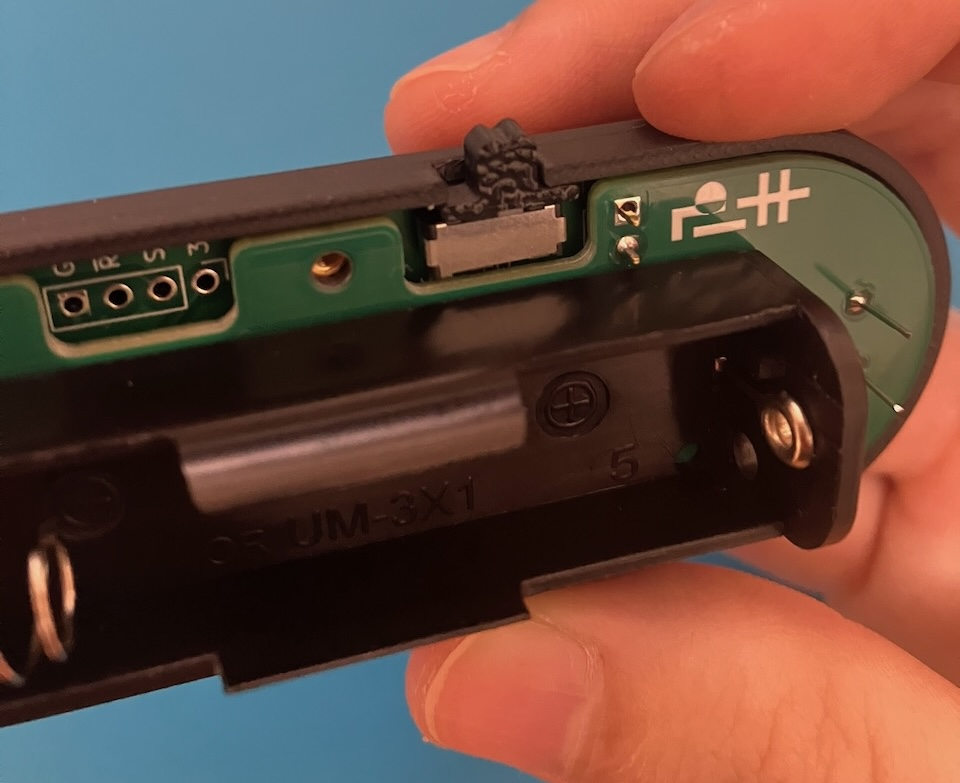

スイッチカバーをスライドスイッチに差し込みます．

#### ケース（後）の取り付け

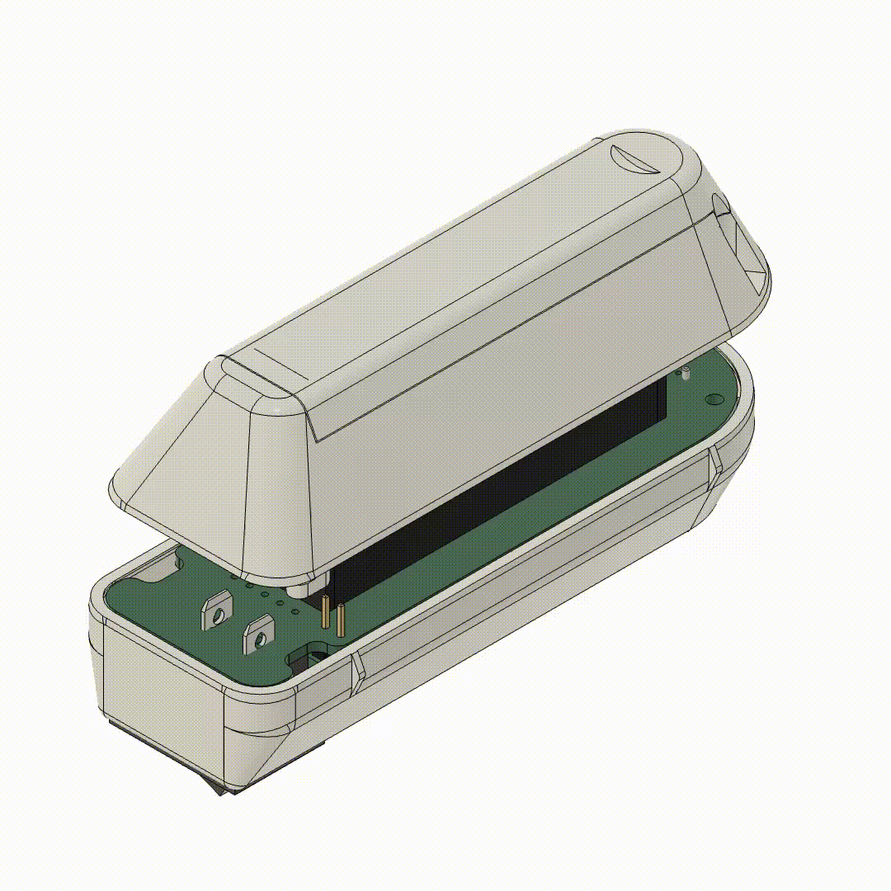

ケース（後）の出っ張りが基板の切り欠きに合うように差し込み，スライドさせてください．

２箇所あるネジ穴に M2 10mm ネジを挿入し，締めてください．

以上で組み立ては完了です．

## 使い方

### 各部名称

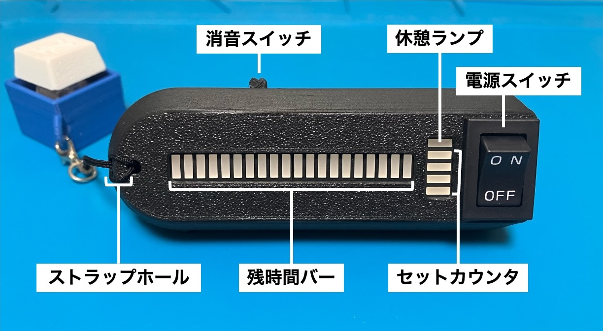

- **電源スイッチ**：電源のオン・オフを切り替えます．
- **休憩ランプ**：休憩時間中に点灯します．
- **セットカウンタ**：集中時間を何回完了したかを表示します（4回でリセット）．
- **残時間バー**：残りの集中・休憩時間を表します．
- **消音スイッチ**：右側にスライドするとブザーが鳴らなくなります．
- **ストラップホール**：ストラップを通すための穴です．

### 電池の取り外し

> [!NOTE]
> - 使用可能な電池は単三形乾電池または充電式ニッケル水素電池(エネループ等)です．
> - 電池の交換は，必ず電源を切ってから行ってください．
> - 電池は正しい向きで挿入してください．逆向きに挿入すると故障の原因となります．
> - 電池が切れた場合，速やかに取り除いてください．
> - 長期間使用しない場合，電池を取り除いてください．

ケース裏面の窪みに爪をかけ，横方向にスライドさせるとケースの裏蓋を外すことができます．
裏蓋を外すと電池ホルダーにアクセスできます．

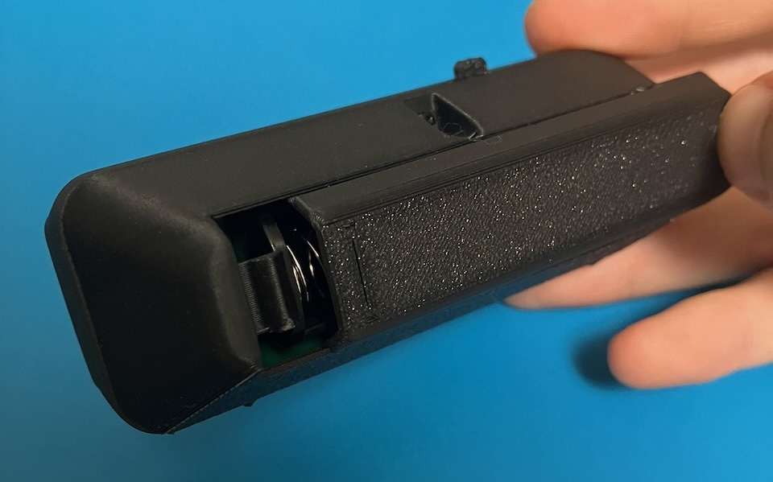

蓋を付けるときは，しっかり溝に嵌っていることを確認し，奥までスライドさせてください．

### 動作説明

本製品は，

- **集中時間**：25分
- **休憩時間**：5分

のセットを繰り返すことで，作業などに集中して取り組めるよう設計されています．

https://github.com/user-attachments/assets/2add35af-41f7-42f3-8dcc-8eead1801370

電源スイッチを入れると集中時間が始まります．
集中時間が終了すると，音とランプの点滅でお知らせし，休憩時間が始まります．
また，セットカウンタが1つ増えます．

休憩終了時にも同様に，音とランプの点滅でお知らせし，自動的に次の集中時間が始まります．
4回集中時間を完了し，セットカウンタが満杯になると，30分の長い休憩が挟まります．
30分休憩が終了すると，セットカウンタがリセットされ，また同様のセットを繰り返すことができます．
